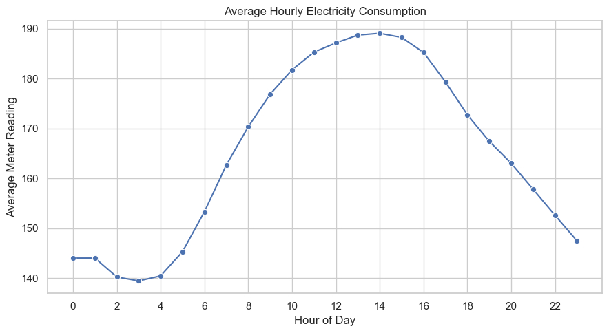
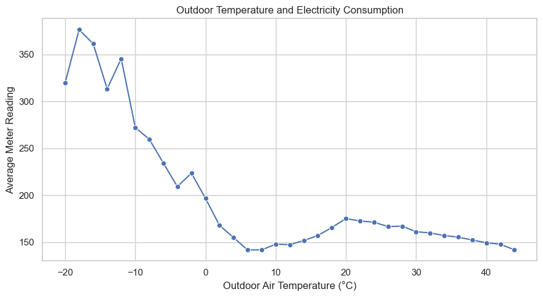
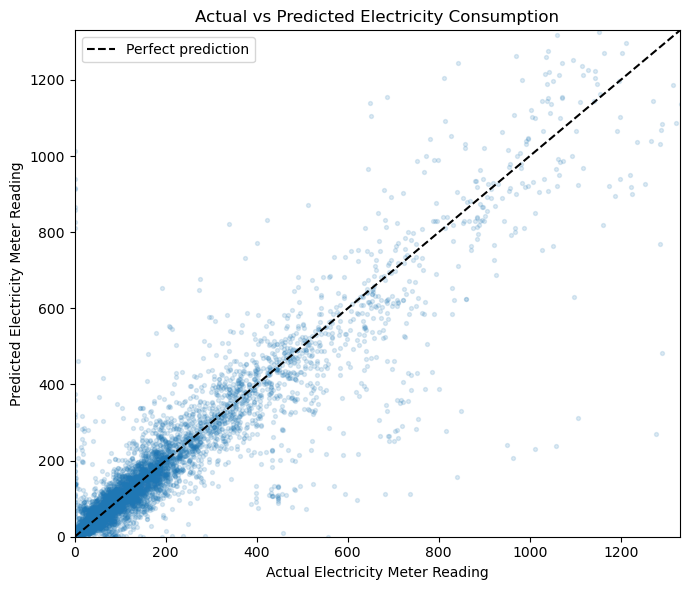

---
format:
  revealjs:
    theme: white
    css: styles.css
    embed-resources: true
    slide-level: 2
    auto-stretch: false
    width: 1280
    height: 720
    transition: none
    slide-number: c/t
    pdf-separate-fragments: false
---

## {.cover background-color="#10283F"}

::: {.eyebrow}
WM_ASDS19 · BIG DATA · SECTION A · SPRING 2026
:::

::: {.cover-title}
Large-Scale Analysis and Prediction of Building Electricity Consumption
:::

::: {.cover-subtitle}
Using Weather and Building Characteristics
:::

::: {.cover-rule}
:::

Group name: **Data Explorers**

::: {.members}
Md. Fahad Rahman (20251702) · Anik Halder (20251703)  
Md. Sohel Rana (20251717) · Md. Ashikul Islam Shohag (20251739)
:::

::: {.cover-footer}
Submitted to: Farhana Akter Bina, Associate Professor  
Department of Statistics & Data Science, Jahangirnagar University 
:::

::: {.notes}
10 seconds. Introduce the group and state the central problem: predicting hourly electricity use from building, time and weather information.
:::

## The problem and dataset

::: {.lead}
Can building characteristics, time and weather improve hourly electricity prediction at scale?
:::

::: {.metrics}
::: {.metric}
[20.22 M]{.number}

Raw training meter readings
:::
::: {.metric}
[12.06 M]{.number}

Electricity readings (meter 0)
:::
::: {.metric}
[11.15 M]{.number}

Retained after excluding Site 0
:::
:::

:::: {.columns}
::: {.column width="55%"}
### Project objectives

- Process large-scale meter and weather data.
- Identify temporal and building-level patterns.
- Predict electricity use and assess the benefit of weather features.
:::
::: {.column width="45%"}
### Data source

ASHRAE Great Energy Predictor III

**Approximately 2.43 GB** across CSV files; 2016 training readings, building metadata and weather observations.
:::
::::

::: {.notes}
30 seconds. The total dataset size refers to the downloaded CSV collection, not just the training file. Focus on electricity readings. Site 0 was excluded in preprocessing; the exact justification should be checked against the preprocessing notebook.
:::

## Big Data processing architecture

::: {.lead}
Two independent preprocessing implementations; one primary analytical workflow.
:::

::: {.pipeline}
::: {.pipe-input}
**Raw CSV files**

Meter readings · building metadata · weather
:::
::: {.pipe-branches}
::: {.pipe-node}
[PRIMARY]{.tag}

**DuckDB**

Filter · join · aggregate
:::
::: {.pipe-node}
[REPRODUCTION]{.tag}

**PySpark**

Independent preprocessing
:::
:::
::: {.pipe-branches}
::: {.pipe-node .result-node}
**Parquet**

Model-ready data → LightGBM
:::
::: {.pipe-node .result-node}
**9 / 9 checks matched**

Dataset-level consistency checks
:::
:::
:::

::: {.small-note}
Join keys: building ID for metadata; site ID and timestamp for weather.
:::

::: {.notes}
50 seconds. Explain why DuckDB and Parquet were used and how PySpark independently reproduced preprocessing. Matching nine checks supports consistency but does not establish row-by-row identity or identical model predictions. Do not claim HDFS or multi-node execution unless confirmed.
:::

## What does electricity use depend on?

:::: {.columns .plot-pair}
::: {.column width="50%"}
### Hour of day

{width=100% fig-alt="Average hourly electricity consumption"}
:::
::: {.column width="50%"}
### Outdoor temperature

{width=100% fig-alt="Outdoor temperature and electricity consumption"}
:::
::::

::: {.takeaway}
These analyses motivate time and weather features; building characteristics provide additional context.
:::

::: {.notes}
30 seconds. Describe the patterns visible in the actual figures. Confirm their axes and units before presenting. Avoid quoting exact peaks or claiming causality.
:::

## Predictive modeling

:::: {.columns}
::: {.column width="52%"}
### Three prediction approaches

1. Historical building-hour median baseline
2. LightGBM without weather
3. LightGBM with weather

::: {.feature-list}
**Building (4):** ID, site, primary use, floor area  
**Time (3):** hour, weekday, month  
**Weather (3):** air temperature, dew point, wind speed
:::
:::
::: {.column width="48%"}
### Chronological holdout

::: {.splitbar}
::: {.train}
74.6%
:::
::: {.validation}
16.9%
:::
::: {.test}
8.5%
:::
:::

| Set | Period (2016) | Rows |
|:---|:---|---:|
| Train | Jan–Sep | 8.32 M |
| Validation | Oct–Nov | 1.89 M |
| Test | Dec | 0.94 M |

**Metrics:** MAE and RMSLE
:::
::::

::: {.small-note}
Both LightGBM models: 200 rounds, learning rate 0.05, 31 leaves; log-transformed target $\ln(1+y)$.
:::

::: {.notes}
35 seconds. Explain the baseline, and the two LightGBM feature sets. The chronological split preserves temporal ordering; leakage prevention also requires train-only fitting of preprocessing and baseline statistics. Predictions are back-transformed using exp(z)-1.
:::

## Weather features improved validation accuracy

:::: {.columns}
::: {.column width="50%"}
### Validation · Oct–Nov

| Approach | MAE | RMSLE |
|:---|---:|---:|
| Baseline | 38.67 | 0.867 |
| LGBM, no weather | 41.04 | 0.723 |
| **LGBM + weather** | **35.93** | **0.694** |

### Test · December

| Approach | MAE | RMSLE |
|:---|---:|---:|
| Baseline | 44.91 | 0.776 |
| **LGBM + weather** | **41.09** | **0.625** |
:::
::: {.column width="50%"}
{width=100% fig-alt="Actual versus predicted electricity consumption"}

::: {.result-callout}
[19.5%]{.number} lower test RMSLE versus baseline
:::
:::
::::

::: {.small-note}
Validation: adding weather reduced MAE by about 12.5% and RMSLE by 4.0% relative to LightGBM without weather.
:::

::: {.notes}
55 seconds. Weather improves both validation metrics relative to LightGBM without weather. On the December holdout, the weather model beats the historical baseline. The no-weather model's December metrics are not supplied; do not claim a test-set weather ablation result. Confirm the metrics and plot against the final modeling notebook.
:::

## Conclusion {background-color="#10283F" .closing}

::: {.closing-hero}
[11.15 million]{.hero-number} retained electricity readings

Processed into a model-ready dataset, with independent PySpark consistency checks.
:::

:::: {.columns}
::: {.column width="50%"}
### Key outcomes

- Scalable DuckDB and Parquet workflow
- Weather improved validation accuracy
- December test RMSLE: **0.6245**
:::
::: {.column width="50%"}
### Limitations and application

- Electricity only; Site 0 excluded
- Generalization beyond December 2016 untested
- Potential use: flag persistent deviations for facilities review
:::
::::

::: {.thanks}
Thank you · Questions & discussion
:::

::: {.notes}
25 seconds. Summarize processing and modeling achievements, acknowledge the restricted evaluation scope and mention the potential facilities-monitoring application. Total planned speaking time: 3 minutes 55 seconds.
:::
