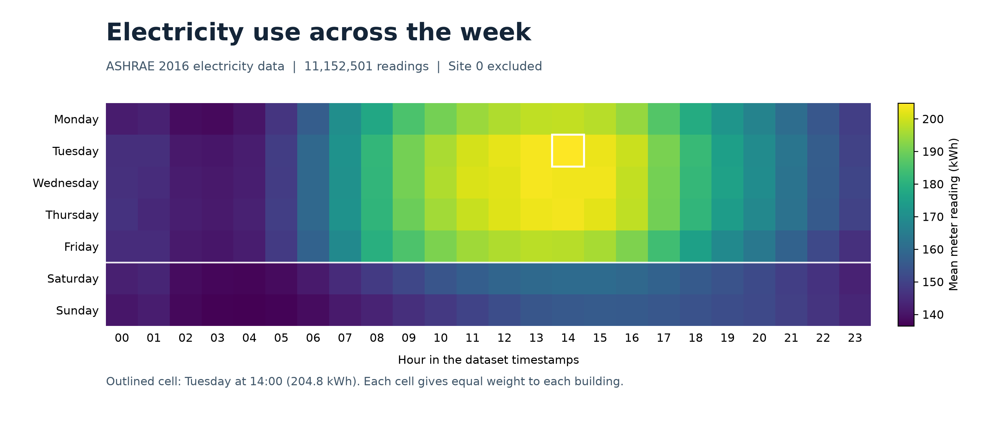

# ASHRAE Full Data PySpark Validation

**Contribution.** Anik Halder ([@nikhofficial-lab](https://github.com/nikhofficial-lab)) ran the independent PySpark validation on the original ASHRAE files, compared the results with DuckDB, and prepared the weekday-by-hour heatmap. Fahad Rahman ([@fahad9993](https://github.com/fahad9993)) produced the reference DuckDB preprocessing and LightGBM results.

PySpark 3.5.9 processed the original ASHRAE competition CSVs on 22 November 2026. All nine reported counts and timestamp checks matched the saved DuckDB results. The run also produced a weekday-by-hour heatmap from the full cleaned dataset.

## Source data and sizes

| Input | File downloaded | Download bytes | CSV bytes read |
| --- | --- | ---: | ---: |
| Meter readings | `train.csv.zip` | 125,587,731 | 678,616,640 |
| Building metadata | `building_metadata.csv` | 45,527 | 45,527 |
| Training weather | `weather_train.csv.zip` | 1,335,561 | 7,450,075 |
| **Three-file total** | | **126,968,819** | **686,112,242** |

The three CSVs occupy **654.33 MiB**. The cleaned Zstandard-compressed Parquet data occupy **51,928,078 bytes (49.52 MiB)**. The competition page lists **2.61 GB** across its six CSVs, which include the competition test data and sample submission. The three inputs processed here fall below 1 GB. The download inventory and the validation JSON preserve the exact sizes and CSV hashes. [ASHRAE competition data](https://www.kaggle.com/competitions/ashrae-energy-prediction/data)

## Comparison with DuckDB

| Check | PySpark on original data | Saved DuckDB results |
| --- | ---: | ---: |
| All meter readings in `train.csv` | 20,216,100 | 20,216,100 |
| Electricity meter readings before excluding Site 0 | 12,060,910 | 12,060,910 |
| Processed electricity readings | 11,152,501 | 11,152,501 |
| Processed readings with air temperature | 11,105,485 | 11,105,485 |
| First timestamp | 2016-01-01 00:00:00 | 2016-01-01 00:00:00 |
| Last timestamp | 2016-12-31 23:00:00 | 2016-12-31 23:00:00 |
| Training, January through September | 8,321,304 | 8,321,304 |
| Validation, October and November | 1,887,642 | 1,887,642 |
| Held-out test, December | 943,555 | 943,555 |

Air-temperature coverage was **99.58%**. The comparison covers the reported counts and timestamps. Report model metrics from the completed LightGBM run on `main`. [DuckDB inspection](https://github.com/fahad9993/bigdata/blob/0f06fc77742f0a6f9adc909f668f590070887dc6/notebooks/01_Data_Inspection.ipynb) · [DuckDB preprocessing](https://github.com/fahad9993/bigdata/blob/0f06fc77742f0a6f9adc909f668f590070887dc6/notebooks/02_Preprocessing.ipynb) · [Final model and date splits](https://github.com/fahad9993/bigdata/blob/0f06fc77742f0a6f9adc909f668f590070887dc6/notebooks/04_Modeling_Full_Data.ipynb)

## Method and runtime

The run used Ubuntu 22.04 under WSL 2, OpenJDK 11, two local Spark threads, and a 2 GiB driver heap. Spark joined the meter data to the building metadata, kept electricity readings outside Site 0, then joined weather by site and hour. The CSV reader strips surrounding spaces before parsing typed values. Building metadata contained 14 square-footage fields with padding. The original files were used as downloaded.

| Phase | PySpark seconds |
| --- | ---: |
| Count raw meter rows | 11.12 |
| Filter, join and write Parquet | 40.93 |
| Verify the written Parquet | 1.71 |
| Aggregate the heatmap | 3.76 |

The successful Spark command ran from **01:14:24 to 01:15:34 Bangladesh time**. The phase figures record wall-clock time on this laptop. A speed comparison with DuckDB would require the same operations and timing boundaries on the same machine.

## Figure for the report or presentation



Spark calculated a mean per building in each weekday-and-hour group, then averaged across the buildings in each cell. The 168 summary cells account for all 11,152,501 readings. Only those summaries were collected for plotting.

**Caption.** Mean hourly electricity readings by weekday and hour, with equal weight for each building represented in a cell. The highest cell is Tuesday at 14:00 (**204.85 kWh**). From 09:00 through 17:00, the mean across weekday cells is **196.49 kWh**, compared with **155.11 kWh** across weekend cells. Times follow the source dataset timestamps.

## Reproduce the run

Extract `train.csv` and `weather_train.csv`, then place them and `building_metadata.csv` in the same input directory. Run from the folder containing these supporting scripts, using the installed Spark executable. Use a fresh path for the results directory.

```bash
SPARK_LOCAL_IP=127.0.0.1 spark-submit --master 'local[2]' --driver-memory 2g \
  --conf spark.driver.bindAddress=127.0.0.1 \
  --conf spark.ui.enabled=false --conf spark.sql.shuffle.partitions=8 \
  validate_ashrae.py /path/to/input_csvs /path/to/new_results

python make_weekday_hour_heatmap.py \
  /path/to/new_results/weekday_hour_summary.csv weekday_hour_heatmap.png
```

The plotting script uses Matplotlib. The JSON files record the source inventory and run checks, the CSV contains the plot data, and the terminal excerpt records the successful run.
